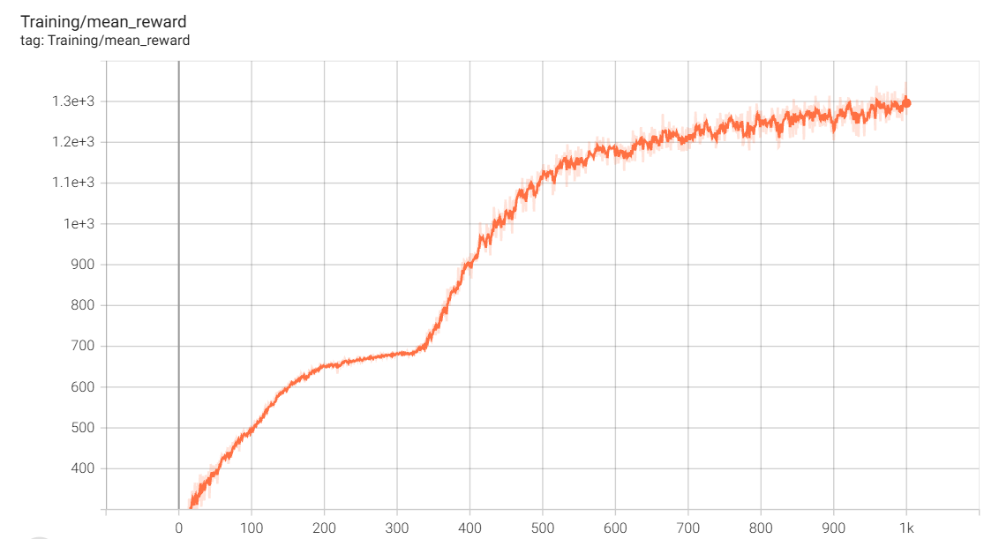
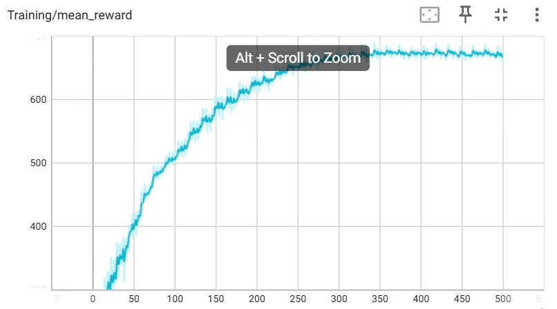
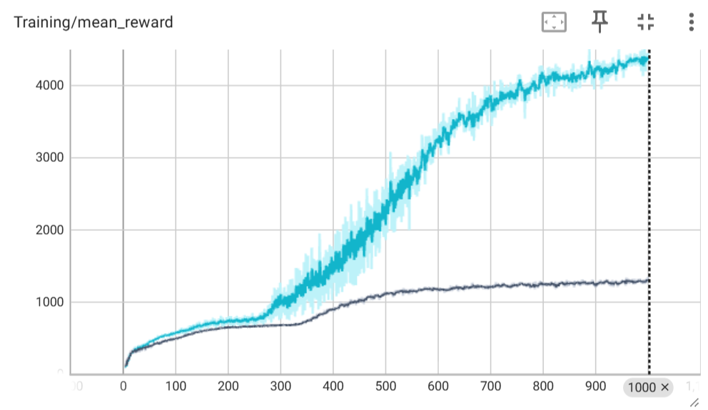
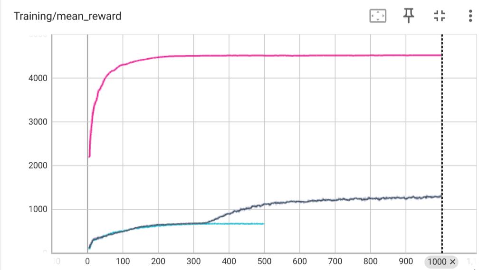
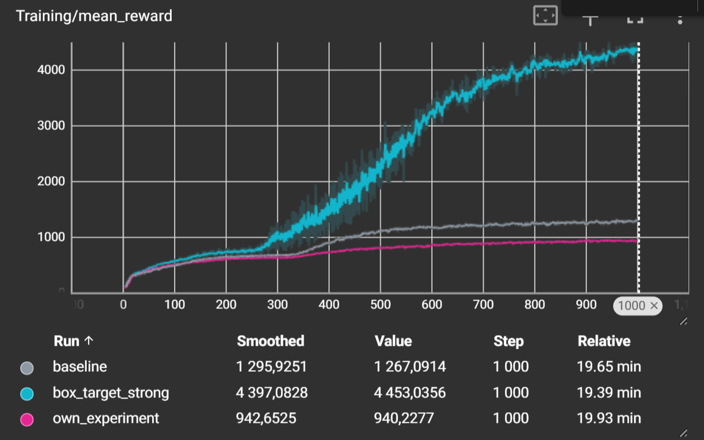

# Отчёт по спринту 3
Есипов Константин, 10 гр

## Цель и условия

Проверено, как длительность обучения и веса награды влияют на PPO-политику PandaPickCube. Во всех пяти опытах обучение начиналось с нуля: 2048 параллельных сред, `seed=1`, `RESUME=None`, сети actor/critic `[512, 256, 128]`, начальный `learning_rate=0.001` с адаптивным расписанием. Baseline адаптирован к доступным ресурсам Colab: 2048 сред вместо исходных 4096 для экономии лимитов Google Colab. Менялся один параметр относительно baseline.

| Параметр | Baseline | Где задаётся | Назначение |
|---|---:|---|---|
| `num_envs` | 2048 | `NUM_ENVS` в ячейке обучения | Число параллельных сред |
| `max_iters` | 1001 | `MAX_ITERS` | Длительность обучения |
| `learning_rate` | 0.001, начальное | `cfg_dict["algorithm"]["learning_rate"]` | Шаг обновления PPO |
| `gripper_box` | 4.0 | `env_cfg.reward_config.scales.gripper_box` | Награда за приближение захвата к кубу |

Веса награды baseline: `box_target=8.0`, `gripper_box=4.0`, `no_floor_collision=0.25`, `robot_target_qpos=0.3`. Настройки подтверждены `experiment.json` и `config.json`.

Финальный `mean_reward` взят из последней итерации обучения, без сглаживания. SR — число успешных эпизодов из 10 при конечном расстоянии куба до цели менее 0.05 м. При оценке использовался seed 42; захват куба сам по себе не считается успехом.

## Результаты

| Эксперимент | Единственное изменение | Финальный mean_reward | Δ к baseline | Время | SR | Δ SR |
|---|---|---:|---:|---:|---:|---:|
| `baseline` | Нет изменений весов; `MAX_ITERS=1001` | 1267.09 | — | 1306 с / 21.8 мин | 8/10 | — |
| `max_iters_500` | `MAX_ITERS = 500` | 659.86 | −607.23 / −47.9% | 533 с / 8.9 мин | Не измерен | — |
| `box_target_strong` | `env_cfg.reward_config.scales.box_target = 40.0` | 4453.04 | +3185.95 / +251.4% | 1285 с / 21.4 мин | 10/10 | +2/10 |
| `qpos_strong` | `env_cfg.reward_config.scales.robot_target_qpos = 30.0` | 4519.55 | +3252.46 / +256.7% | 962 с / 16.0 мин | Не измерен | — |
| `own_experiment` | `env_cfg.reward_config.scales.box_target = 4.0` | 940.23 | −326.86 / −25.8% | 1209 с / 20.1 мин | Не измерен | — |

Пропуски в таблице возникли из-за путаницы и ослложнений работы с Colab, в том числе с истечением лимитов.

## Кривые и наблюдения

### 1. Baseline

Сначала награда растёт примерно до 680, после 330–350 итераций начинается второй подъём. К концу рост замедляется около 1300, но полностью горизонтального плато нет. На оценке робот поднимает куб во всех десяти эпизодах; в восьми доставляет его достаточно близко к цели. Две неудачи имеют конечные расстояния 0.074 и 0.059 м.

### 2. Сокращение обучения

Кривая выходит на локальное плато примерно к 300-й итерации и остаётся около 670 до конца. Относительно baseline время сокращено на 59.2%, награда снижена на 47.9%. Этот запуск не достиг второго подъёма, видимого у baseline. Поведение финальной модели на инференсе не оценено.

### 3. Усиление box_target

Верхняя кривая — `box_target_strong`, нижняя — baseline. После примерно 250 итераций усиленный вариант быстро растёт и заканчивает обучение с наградой 4453.04. При повторной оценке получен SR 10/10 против 8/10 у baseline; в эпизодах 9–10 расстояния составили 0.007 и 0.004 м. Это согласуется с усилением стимула доставлять куб к цели, однако десять эпизодов и один seed не доказывают устойчивого превосходства во всех условиях.

### 4. Усиление robot_target_qpos

Верхняя розовая кривая — `qpos_strong`: быстрый рост и раннее устойчивое плато около 4520. Нижняя растущая кривая — baseline, короткая кривая до 500 итераций — `max_iters_500`. В последней строке обучения у `qpos_strong` компонента `robot_target_qpos=0.9922`, а `box_target=0.0000`: это согласуется с приоритетом сохранения стартовой позы. Без отдельного инференса нельзя утверждать ни фактический SR=0, ни наблюдавшуюся неподвижность робота.

### 5. Собственный эксперимент

На графике собственный опыт — нижняя розовая линия; baseline — серая, `box_target_strong` — верхняя голубая. Гипотеза: уменьшение `box_target` с 8.0 до 4.0 снизит награду и может снизить SR, поскольку доставка куба поощряется слабее. Награда действительно снизилась до 940.23, на 25.8% относительно baseline: эта часть гипотезы подтвердилась. По SR гипотеза не проверена из-за лимита Colab. Объяснение снижения награды включает само уменьшение веса, поэтому оно не является самостоятельным доказательством ухудшения поведения.

## Ограничения и проверка данных

Лимиты Google Colab существенно осложнили работу: ограниченная доступность GPU и продолжения сессий не позволила выполнить все повторные оценки. Дополнительно потребовалось устранить конфликт CUDA-плагинов JAX. Обучения всех пяти моделей завершены, финальные чекпоинты сохранены.

В TensorBoard-файле `box_target_strong` сохранён только заголовок. Финальные числа этого опыта подтверждаются выводом ноутбука и извлечённым CSV. Colab также обрезал текст обучения в ноутбуках до последних 5000 строк: сохранённые CSV содержат по 208 последних полных итераций. Время и показатели таблицы получены из выводов обучения.

## Выводы и итог

Сокращение обучения снизило награду и затраты времени; влияние на SR осталось непроверенным. Усиление основной компоненты `box_target` повысило награду и сопровождалось улучшением измеренного SR с 8/10 до 10/10. Усиление вспомогательной компоненты `robot_target_qpos` дало наибольшую награду, но структура награды обучения указывает на смещение приоритета к стартовой позе; подтвердить поведение инференсом не удалось. Собственный опыт подтвердил прогноз снижения награды при уменьшении `box_target`, но не позволил проверить прогноз по SR.

Итого выполнены пять обучений, сравнение кривых и самостоятельный эксперимент; SR доступен для двух моделей. По имеющимся измерениям лучший результат у `box_target_strong` — 10/10. Полное ранжирование пяти моделей по качеству требует трёх оставшихся оценок после восстановления доступа к GPU.

Настройки, чекпоинты и доказательства: [папки экспериментов](../experiments/). Сводные данные: [CSV](../results.csv).
